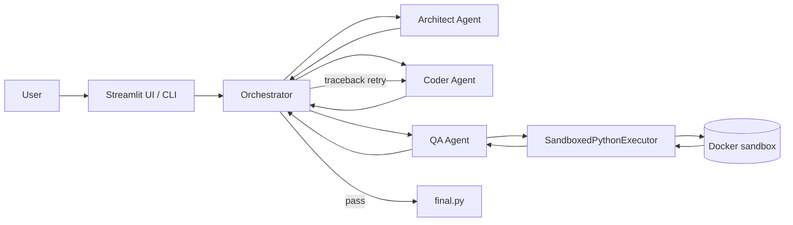

# AutoDev.py Technical Documentation

> Version: v0.1.0  
> Status: local-first portfolio release  
> Stack: Python 3.11, Streamlit, CrewAI, Ollama, Docker, pytest, Ruff, GitHub Actions

AutoDev.py is a self-correcting Python code-generation system. A user gives it a natural language task; the system plans the work, writes a Python script, executes that script in a constrained Docker sandbox, and retries with the exact traceback when execution fails.

The project is production-leaning because it treats generated code as untrusted, makes orchestration observable, and enforces the critical guarantees in CI.

## Reviewer Summary

| Area | Current implementation |
|---|---|
| User surface | Streamlit dashboard and `pr-agent` CLI |
| Agent flow | Architect -> Coder -> QA |
| Execution | Docker-backed `SandboxedPythonExecutor`; no host fallback |
| Isolation | No network in CI, read-only rootfs, tmpfs-only workspace, non-root user, dropped caps, resource caps |
| Orchestration | Explicit state machine with JSONL transition logs |
| Failure handling | Bounded retries, repeated-traceback circuit breaker, Docker infrastructure fail-closed behavior |
| UI resilience | Ollama health check, stop/cancel, session reload from workspace |
| CI | Ruff, unit tests, package build, Docker builds, adversarial sandbox suite |
| Release | v0.1.0 tag and GHCR app/sandbox images |

## Architecture



The orchestrator is the only component allowed to decide what happens next. Agents return outputs; they do not call each other directly. This keeps the pipeline debuggable and makes every retry/failure path testable.

## State Machine

Implemented states:

- `IDLE`
- `PLANNING`
- `CODING`
- `EXECUTING`
- `RETRYING`
- `SUCCEEDED`
- `FAILED`
- `CANCELLED`

Every transition is written to `workspace/sessions/{session_id}/execution_log.jsonl` with:

- timestamp
- from-state
- to-state
- attempt number, where applicable
- reason

Example transition record:

```json
{
  "agent": "system",
  "message": "STATE EXECUTING -> RETRYING (attempt failed and retry budget remains)",
  "level": "info",
  "timestamp": "2026-07-03T09:00:00",
  "event_type": "state_transition",
  "from_state": "EXECUTING",
  "to_state": "RETRYING",
  "attempt_number": 1,
  "reason": "attempt failed and retry budget remains"
}
```

### Retry Rules

1. Architect creates a plan once.
2. Coder writes attempt `n`.
3. QA executes attempt `n` in Docker.
4. If execution passes, the session enters `SUCCEEDED`.
5. If execution fails and retry budget remains, stderr becomes the next Coder error context.
6. If the same stderr appears twice consecutively, the circuit breaker enters `FAILED`.
7. If the sandbox infrastructure is unavailable, the run enters `FAILED` immediately; there is no host fallback.
8. If the UI cancel signal is set during execution, the executor removes the running sandbox container and the session enters `CANCELLED`.

## Sandbox Security Model

Generated Python is treated as untrusted. The QA path uses `SandboxedPythonExecutor` and refuses to run when Docker or the configured sandbox image is unavailable.

Docker controls:

```text
--network=none
--cpus=1
--memory=128m
--memory-swap=128m
--pids-limit=64
--read-only
--cap-drop=ALL
--security-opt=no-new-privileges
--user=1000:1000
--tmpfs /workspace:rw,noexec,nosuid,nodev,size=16m,mode=1777
--tmpfs /tmp:rw,noexec,nosuid,nodev,size=16m,mode=1777
```

Important design choices:

- Generated code is passed through stdin.
- There is no writable host bind mount.
- Local network access is opt-in with `SANDBOX_ALLOW_NETWORK=1`.
- CI always forces networking off.
- Timeout and cancellation paths both remove the named Docker container.

## Adversarial Test Suite

The Docker-marked test suite runs payloads through the real executor path.

| Payload | Expected behavior |
|---|---|
| Outbound network call | fails or times out under `--network=none` |
| Fork/process storm | blocked by PID limit or timeout |
| Disk fill | hits tmpfs cap without growing host files |
| Infinite loop | killed by executor timeout |
| `/etc/passwd` read | exposes only container-scoped data |
| Memory exhaustion | killed or fails under memory cap |
| Mid-execution cancellation | removes running container and returns `cancelled` |

Each test also asserts:

- no host escape marker file exists
- no sandbox container remains running
- no writable host path was mounted
- failure is classified as contained even if the payload catches its own exception

## UI Resilience

The Streamlit app now handles the operational cases that matter in a demo:

- polls Ollama health on startup and shows online/offline status
- disables task editing while a run is active
- exposes a stop button while running
- sends a cooperative cancel event into the orchestrator and executor
- reports `CANCELLED` instead of hanging silently
- reloads prior sessions from `workspace/sessions/` on startup

The cancellation path is intentionally cooperative: it does not interrupt arbitrary Python state inside the orchestrator. It waits for safe boundaries and, during sandbox execution, removes the container before returning.

## CLI and Packaging

`pyproject.toml` defines the package and console script:

```bash
pip install -e .
pr-agent --version
pr-agent run "Write a Python script that prints hello"
pr-agent ui
```

The CLI performs an Ollama health check before starting a live agent run. If Ollama is unavailable, it exits before CrewAI attempts downstream LLM calls.

## CI Pipeline

Pull requests and pushes run:

1. install package in editable dev mode
2. `ruff check .`
3. `pytest -m "not docker"`
4. `pr-agent --version`
5. `python -m build`
6. build app Docker image
7. build sandbox Docker image
8. run `pytest -m docker`

Tag pushes run the same gate and then push release Docker images to GHCR.

Nightly/manual workflow:

- installs Ollama
- starts `ollama serve`
- pulls `qwen2.5-coder:7b`
- runs the live smoke test

This split keeps PR checks deterministic while still verifying live model integration regularly.

## Demo Narrative

Target length: 60-90 seconds.

1. Show the README opening: sandbox, state machine, CI gate are visible immediately.
2. Open the app and point out Ollama health and session history.
3. Submit a task that produces a JSON parsing bug in attempt 1.
4. Show QA returning the traceback.
5. Show the orchestrator entering `RETRYING`.
6. Show Coder receiving the traceback and producing attempt 2.
7. Show QA passing and `final.py` becoming available.
8. Close on the security model: the generated script never executed on the host.

The repository includes `media/autodev-demo.mp4` as a compact reviewer-facing demo asset for this flow.

## Limitations

- The app is local-first and single-user.
- It depends on a local Ollama model for live agent execution.
- Loop 1 targets standard-library generated scripts; third-party dependency installation inside the sandbox is intentionally out of scope.
- The sandbox is Docker-based process isolation, not a remote multi-tenant execution platform.
- Session storage is filesystem-backed, not a database.

## Interview Framing

Use this framing with reviewers:

> AutoDev.py is not just a code-generation UI. The technical point is the closed feedback loop around untrusted generated code. I made the orchestration explicit, persisted every transition, put generated scripts behind a constrained Docker boundary, and added CI tests that try to break that boundary. That is what makes it production-leaning rather than a simple agent demo.

## File Map

| Path | Purpose |
|---|---|
| `app.py` | Streamlit UI, health display, cancellation, session history |
| `src/orchestrator.py` | State machine, retry logic, circuit breakers |
| `src/agents/` | Architect, Coder, QA wrappers |
| `src/tools/python_executor.py` | Docker-backed sandbox executor |
| `src/session_store.py` | Workspace session reload |
| `src/health.py` | Ollama health check |
| `tests/test_sandbox_adversarial.py` | Real Docker containment tests |
| `.github/workflows/ci.yml` | CI, nightly Ollama smoke, release image publishing |
| `sandbox.Dockerfile` | Minimal Python sandbox runtime |
| `Dockerfile` | Streamlit app image |
