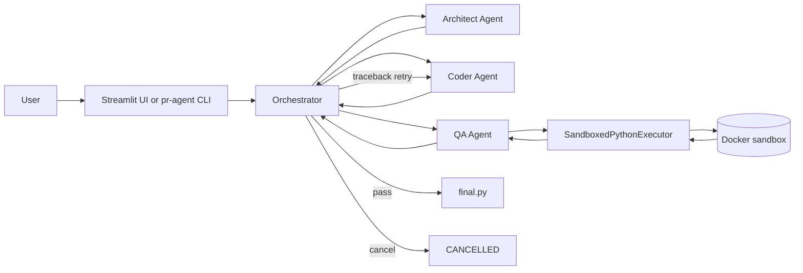

# AutoDev.py

AutoDev.py is a local, self-correcting Python coding agent. It accepts a natural
language task, plans the implementation, writes a Python script, executes that
script in a constrained Docker sandbox, and retries with the exact traceback when
the generated code fails.

The project is local-first. It uses Ollama for model inference (with an optional
hosted OpenAI or Gemini model), Streamlit and FastAPI as front ends, and Docker
for generated-code isolation. The core
engineering goal is not just code generation; it is an observable feedback loop
around untrusted generated code.

## Highlights

| Area | Implementation |
|---|---|
| User interfaces | Streamlit dashboard, `pr-agent` CLI, FastAPI job API with SSE streaming |
| Agent flow | Architect -> Coder -> QA, or a tool-calling mode where the model drives |
| Model backend | Local Ollama via CrewAI's `LLM` class; hosted OpenAI/Gemini via `LLM_MODEL` |
| Tool use | `run_code`, `read_attempt`, `search_past_fixes` bound with LangChain `bind_tools` |
| Memory | Traceback-and-fix pairs embedded and retrieved into the Coder prompt across sessions |
| Evaluation | 50-task MBPP-style benchmark measuring traceback-feedback lift |
| Execution | Docker-backed `SandboxedPythonExecutor`; no host fallback |
| Orchestration | Explicit state machine with JSONL transition logs |
| Failure handling | Bounded retries, repeated-traceback circuit breaker, fail-closed sandbox checks |
| CI coverage | Ruff, unit tests, package build, Docker builds, adversarial sandbox tests, nightly benchmark |
| Demo asset | `media/autodev-demo.mp4` |

## Architecture



The orchestrator owns every state transition. Agents return outputs to the
orchestrator; they do not call each other directly. This keeps retries,
failures, cancellation, and session persistence inspectable.

Runtime states:

```text
IDLE -> PLANNING -> CODING -> EXECUTING -> SUCCEEDED
                         |         |
                         |         -> RETRYING -> CODING
                         |         -> FAILED
                         |         -> CANCELLED
                         -> FAILED
```

Each session writes artifacts under `workspace/sessions/{session_id}/`:

| Artifact | Purpose |
|---|---|
| `task.txt` | Original user task |
| `plan.md` | Architect plan |
| `attempt_1.py`, `attempt_2.py`, ... | Generated code attempts |
| `final.py` | Passing script, written only after successful execution |
| `execution_log.jsonl` | Timestamped agent logs and state transitions |

## Quick Start

Prerequisites:

- Python 3.11+
- Docker daemon running locally
- Ollama running at `http://localhost:11434`
- `qwen2.5-coder:7b` pulled locally, or `OLLAMA_MODEL` set to another available model

```bash
git clone https://github.com/praveen-dhankhar/AutoDev.Py.git
cd AutoDev.Py

python3.11 -m venv .venv
source .venv/bin/activate
pip install -e .

docker build -f sandbox.Dockerfile -t autodev-py-sandbox:latest .
ollama pull qwen2.5-coder:7b
ollama pull nomic-embed-text   # optional: enables long-term fix memory
cp .env.example .env
```

Start the dashboard:

```bash
pr-agent ui
```

The app opens at `http://localhost:8501`.

Run from the CLI:

```bash
pr-agent run "Write a Python script that prints the Fibonacci sequence up to 10"
```

The CLI checks Ollama before starting a live run and exits early if the local
model server is unavailable.

## Tool-Calling Mode

```bash
pr-agent run --tools "Write a function that returns the nth prime and test it"
```

By default the orchestrator decides when to execute code. With `--tools`, the
model decides instead. `src/agents/tool_agent.py` binds three tools with
LangChain's `ChatOllama.bind_tools` and loops until the model stops calling
tools or a run passes:

| Tool | What it does |
|---|---|
| `run_code(code)` | Saves the next `attempt_N.py`, runs it in the Docker sandbox, returns PASS or FAIL with the traceback |
| `read_attempt(n)` | Returns the code and result of an earlier attempt |
| `search_past_fixes(error)` | Queries long-term memory for similar tracebacks |

The tools still go through the orchestrator, so the state log looks the same as
in the default mode (`CODING -> EXECUTING -> RETRYING -> ...`), and the retry
budget, cancellation, and non-retriable sandbox checks still apply. The CLI
first asks Ollama's `/api/show` whether the model reports the `tools`
capability, and refuses to start if it doesn't.

## Long-Term Fix Memory

When a failed attempt is followed by a passing one, the orchestrator embeds
the traceback with `nomic-embed-text` (via Ollama's `/api/embed`). It stores
the traceback with the fixed code in `workspace/memory/fixes.jsonl`. On a later
failure, in any session, the most similar past fixes (cosine similarity ≥ 0.6,
top 2) are added to the Coder's retry prompt. In tool mode, the model can query
them through `search_past_fixes`.

If the embedding model is unavailable, the run carries on without memory.

## HTTP API

```bash
pr-agent serve --port 8000
```

| Endpoint | Purpose |
|---|---|
| `POST /jobs` | Start a job: `{"task": "...", "max_retries": 3, "mode": "classic" \| "tools"}` |
| `GET /jobs/{id}` | Status, attempt count, final code |
| `GET /jobs/{id}/events` | Server-Sent Events: replays every state change and log entry so far, then follows live |
| `POST /jobs/{id}/cancel` | Cancel a running job |

```bash
curl -s -X POST localhost:8000/jobs -H 'Content-Type: application/json' \
  -d '{"task": "print the first 10 primes"}'
curl -N localhost:8000/jobs/<job_id>/events
```

The server binds to `127.0.0.1` by default. Set `API_TOKEN` to require
`Authorization: Bearer <token>`. `MAX_CONCURRENT_JOBS` caps how many jobs run at
once; extra requests get HTTP 429.

## Hosted Models

Set `LLM_MODEL` to run the Architect and Coder on a hosted model instead of
Ollama. This makes the API cheap to deploy without a GPU.

```bash
LLM_MODEL=openai/gpt-4o-mini OPENAI_API_KEY=... pr-agent run "..."
LLM_MODEL=gemini/gemini-2.0-flash GEMINI_API_KEY=... pr-agent run "..."  # pip install "crewai[google-genai]"
```

Tool mode and fix memory still need Ollama.

## Benchmark

`evals/` runs the self-correction loop on 50 MBPP-style tasks. Each task comes
with assert-based tests, which are shown to the agent and appended to every
executed script, so a run passes only if the assertions pass. Each task also
has a reference solution, and a unit test checks that every task's assertions
pass against it.

```bash
python -m evals.run                                   # all tasks: feedback vs no-feedback
python -m evals.run --limit 20 --conditions feedback,no-feedback,memory
python -m evals.run --mode tools                      # benchmark tool-calling mode
OLLAMA_MODEL=llama3.1:8b python -m evals.run          # compare models
```

| Condition | Retries see |
|---|---|
| `feedback` | The previous traceback (normal behaviour) |
| `no-feedback` | Only the task, so each retry is a fresh sample (ablation baseline) |
| `memory` | Traceback plus retrieved past fixes, starting from an empty store |

It reports the first-try pass rate, the pass rate after retries, average
retries per task, and the **traceback feedback lift** (the pass rate after
retries with feedback minus the same rate without it). The Architect is skipped
so the numbers isolate the Coder -> sandbox -> retry loop. Results are written
to `evals/results/*.json`. The nightly workflow runs the first 20 tasks and
uploads the JSON as an artifact.

## Configuration

Configuration is loaded from environment variables and `.env`.

| Variable | Default | Description |
|---|---|---|
| `OLLAMA_MODEL` | `qwen2.5-coder:7b` | Local Ollama model |
| `OLLAMA_BASE_URL` | `http://localhost:11434` | Ollama server URL |
| `MAX_RETRIES` | `3` | Maximum self-correction attempts |
| `SUBPROCESS_TIMEOUT` | `30` | Sandbox execution timeout in seconds |
| `AGENT_CALL_TIMEOUT` | `60` | Local LLM call timeout in seconds |
| `WORKSPACE_DIR` | `./workspace` | Session artifact root |
| `SANDBOX_IMAGE` | `autodev-py-sandbox:latest` | Docker image used for generated code |
| `SANDBOX_ALLOW_NETWORK` | `0` | Local sandbox network opt-in; ignored in CI |
| `LLM_MODEL` | empty | Hosted model, e.g. `openai/gpt-4o-mini`; empty means Ollama |
| `EMBED_MODEL` | `nomic-embed-text` | Ollama embedding model for fix memory |
| `API_TOKEN` | empty | Bearer token for the HTTP API; empty disables auth |
| `MAX_CONCURRENT_JOBS` | `2` | Concurrent HTTP API jobs |

## Sandbox Model

Generated Python is treated as untrusted. The QA path executes generated code
only through Docker. If Docker or the configured sandbox image is unavailable,
the run fails closed instead of falling back to host execution.

Sandbox controls:

```text
--network=none
--cpus=1
--memory=128m
--memory-swap=128m
--pids-limit=64
--read-only
--cap-drop=ALL
--security-opt=no-new-privileges
--user=1000:1000
--tmpfs /workspace:rw,noexec,nosuid,nodev,size=16m,mode=1777
--tmpfs /tmp:rw,noexec,nosuid,nodev,size=16m,mode=1777
```

Important behavior:

- Generated code is passed to the container through stdin.
- No writable host directory is mounted into the sandbox.
- CI forces sandbox networking off even if local network opt-in is configured.
- Timeout and cancellation paths remove the named sandbox container.

The adversarial Docker test suite covers outbound network access, process storms,
disk fill attempts, infinite loops, container-scoped file reads, memory pressure,
and mid-execution cancellation cleanup.

## Development

Install development dependencies:

```bash
python3.11 -m venv .venv
source .venv/bin/activate
pip install -e ".[dev]"
```

Run the standard local checks:

```bash
ruff check .
pytest
```

Run Docker-marked sandbox tests:

```bash
docker build -f sandbox.Dockerfile -t autodev-py-sandbox:local-test .
SANDBOX_REQUIRED=1 \
SANDBOX_IMAGE=autodev-py-sandbox:local-test \
SANDBOX_ALLOW_NETWORK=0 \
pytest -m docker
```

## CI and Release

The GitHub Actions workflow runs the deterministic quality gates on pull
requests and pushes:

1. `ruff check .`
2. `pytest -m "not docker"`
3. `pr-agent --version`
4. `python -m build`
5. Build the app Docker image
6. Build the sandbox Docker image
7. `pytest -m docker`

Tag pushes also build and push the app and sandbox images to GHCR. A scheduled
and manually triggered workflow installs Ollama, pulls `qwen2.5-coder:7b`, runs
the live Ollama smoke test, then runs the benchmark on 20 tasks. Results go to
the job summary and an `eval-results` artifact.

## Performance Benchmarks

Latest local k6 run against the warmed Streamlit HTTP surface:

- Target: `http://localhost:8501`
- Load shape: `10 VUs`, `30s`, `300 iterations`, `600 HTTP requests`
- Result: `0` failed requests, `100%` checks passed, `19.77 req/s`
- Evidence: `loadtests/results/k6_streamlit_20260704-001000.txt`

| Endpoint | p95 | p99 | Average | Max |
|---|---:|---:|---:|---:|
| Overall | 9.81 ms | 19.61 ms | 5.12 ms | 20.22 ms |
| `/_stcore/health` | 4.35 ms | 5.31 ms | 2.51 ms | 5.72 ms |
| `/` | 10.69 ms | 19.79 ms | 7.73 ms | 20.22 ms |

Reproduce the HTTP latency test:

```bash
TARGET_URL=http://localhost:8501 \
VUS=10 \
DURATION=30s \
k6 run loadtests/k6_streamlit_latency.js
```

These numbers measure warmed local Streamlit HTTP latency only. They do not
measure full LLM generation, Docker sandbox execution, or end-to-end agent
pipeline latency.

## Project Layout

| Path | Purpose |
|---|---|
| `app.py` | Streamlit dashboard, run controls, session display |
| `src/cli.py` | `pr-agent` command-line entry point |
| `src/orchestrator.py` | State machine, retries, cancellation, circuit breakers, tool mode |
| `src/agents/` | Architect, Coder, QA wrappers and the LangChain tool-calling loop |
| `src/memory.py` | Embedded traceback-and-fix store |
| `src/api.py` | FastAPI job service with SSE |
| `evals/` | MBPP-style tasks and benchmark runner |
| `src/tools/python_executor.py` | Docker-backed sandbox executor |
| `src/session_store.py` | Workspace session reload |
| `src/health.py` | Ollama health check |
| `tests/` | Unit, orchestration, CLI, health, executor, and sandbox tests |
| `loadtests/` | k6 HTTP latency script and captured benchmark output |
| `Dockerfile` | Streamlit app image |
| `sandbox.Dockerfile` | Minimal Python runtime for generated code |

## Limitations

- The app is local-first and single-user.
- Live agent execution depends on a local Ollama model.
- Generated scripts run in a Python sandbox image; installing arbitrary third-party
  dependencies inside generated code is intentionally out of scope.
- The Docker sandbox is local process isolation, not a remote multi-tenant
  execution platform.
- Session storage is filesystem-backed under `workspace/`, not database-backed.
- API jobs are held in memory and lost on restart.
- Fix memory is a linear scan over a JSONL file, which is fine for thousands of
  fixes. A vector store would be needed beyond that.
- Tool mode and fix memory depend on Ollama even when `LLM_MODEL` is set.
