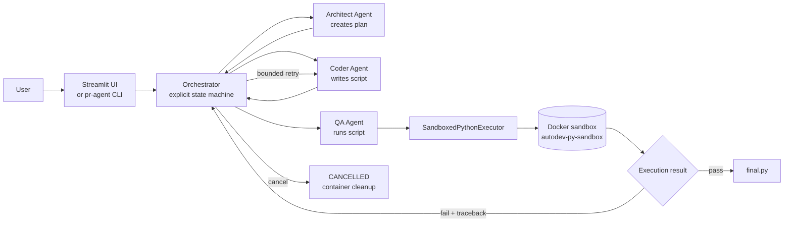
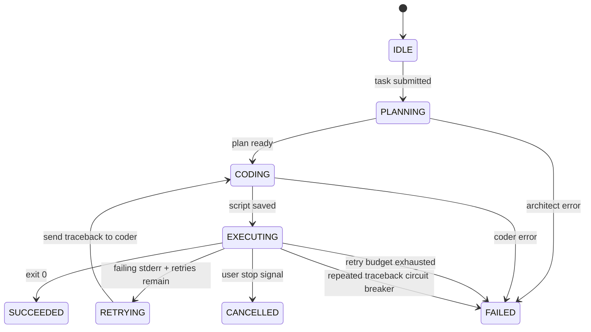

# AutoDev.py - Automated Software Engineer

AutoDev.py is a local multi-agent system that plans, writes, executes, and self-corrects Python scripts. It is built as a portfolio-grade agent project: generated code runs in a Docker sandbox, orchestration is an explicit state machine, and CI blocks regressions in isolation and retry behavior.

## 30-Second Review

| What matters | Where it shows up |
|---|---|
| Real execution feedback loop | Architect -> Coder -> QA -> traceback retry -> final script |
| Sandboxed generated code | Docker executor with no network in CI, read-only rootfs, tmpfs workdir, non-root user, CPU/memory/PID caps |
| Observable orchestration | `PLANNING -> CODING -> EXECUTING -> RETRYING -> SUCCEEDED/FAILED/CANCELLED` logged to `execution_log.jsonl` |
| Regression protection | GitHub Actions runs Ruff, unit tests, package build, both Docker builds, and adversarial sandbox tests |
| Reviewer demo | [60-90s self-correction demo](media/pr-agent-demo.mp4) plus the example below |

## Architecture



The orchestrator owns all state transitions. Agents do not call each other directly; each step returns data to the orchestrator, which decides the next state, persists artifacts, and writes structured transition logs.



## Self-Correction Example

The demo flow intentionally shows a realistic generated-code failure and recovery.

Attempt 1:

```python
response = requests.get(url)
data = json.loads(response)     # Bug: Response is not a JSON string
```

QA result:

```text
TypeError: the JSON object must be str, bytes or bytearray, not Response
```

Attempt 2:

```python
response = requests.get(url)
data = response.json()
```

The exact traceback is sent back into the Coder prompt. If the same traceback repeats twice, the circuit breaker stops early instead of wasting all retry attempts.

## Security Model

Loop 1 moved generated-code execution out of the host process and into a Docker-backed sandbox. The QA path uses `SandboxedPythonExecutor` only; if Docker or the sandbox image is unavailable, execution fails closed and never falls back to host subprocess execution.

Sandbox controls:

- `--network=none` by default; CI forces network off even if local opt-in is set.
- `--read-only` root filesystem.
- No writable host bind mount; generated code receives stdin and writes only to ephemeral container tmpfs.
- Tmpfs workspace and `/tmp` capped at 16 MB.
- Non-root `sandbox` user (`1000:1000`).
- `--cap-drop=ALL` and `--security-opt=no-new-privileges`.
- `--cpus=1`, `--memory=128m`, `--memory-swap=128m`, `--pids-limit=64`.
- Executor timeout removes the running container; UI cancellation also removes the active container before returning `CANCELLED`.

Adversarial verification runs through the real executor path and covers:

- outbound network call
- fork/process storm
- disk fill
- infinite loop
- `/etc/passwd` read scope
- memory exhaustion
- mid-execution cancellation cleanup

Each test also asserts there are no sandbox container leaks and no host marker files were written.

## CI and Release Gates

`.github/workflows/ci.yml` is intentionally stricter than basic `pytest`:

1. `ruff check .`
2. `pytest -m "not docker"`
3. `pr-agent --version`
4. `python -m build`
5. build the app Docker image
6. build the sandbox Docker image
7. `pytest -m docker` adversarial sandbox suite

Tag pushes (`v*`) also build and push release images to GHCR:

- `ghcr.io/praveen-dhankhar/autodev-py-app:v0.1.0`
- `ghcr.io/praveen-dhankhar/autodev-py-sandbox:v0.1.0`

Nightly/manual CI runs the live Ollama smoke test separately because it is slower and depends on pulling a local model.

## Quick Start

```bash
git clone https://github.com/praveen-dhankhar/AutoDev.Py.git
cd AutoDev.Py
python3.11 -m venv .venv
source .venv/bin/activate
pip install -e .
docker build -f sandbox.Dockerfile -t autodev-py-sandbox:latest .
ollama pull qwen2.5-coder:7b
cp .env.example .env
pr-agent ui
```

The app opens at `http://localhost:8501`. Docker must be running so generated scripts execute inside the sandbox, and Ollama must be running at `http://localhost:11434`.

CLI mode:

```bash
pr-agent run "Write a Python script that prints the Fibonacci sequence up to 10"
```

`pr-agent run` performs an Ollama health check before starting the agent loop and exits early if the local model server is unavailable.

## Development

```bash
python3.11 -m venv .venv
source .venv/bin/activate
pip install -e ".[dev]"
ruff check .
pytest
```

Docker-marked tests require Docker and a built sandbox image:

```bash
docker build -f sandbox.Dockerfile -t autodev-py-sandbox:local-test .
SANDBOX_REQUIRED=1 \
SANDBOX_IMAGE=autodev-py-sandbox:local-test \
SANDBOX_ALLOW_NETWORK=0 \
pytest -m docker
```

## Environment Variables

| Variable | Default | Description |
|---|---|---|
| `OLLAMA_MODEL` | `qwen2.5-coder:7b` | Local Ollama model |
| `OLLAMA_BASE_URL` | `http://localhost:11434` | Ollama server URL |
| `MAX_RETRIES` | `3` | Max self-correction attempts |
| `SUBPROCESS_TIMEOUT` | `30` | Sandbox execution timeout in seconds |
| `AGENT_CALL_TIMEOUT` | `60` | Local LLM call timeout in seconds |
| `WORKSPACE_DIR` | `./workspace` | Session artifact root |
| `SANDBOX_IMAGE` | `autodev-py-sandbox:latest` | Docker image used for generated code |
| `SANDBOX_ALLOW_NETWORK` | `0` | Local-only network opt-in; ignored in CI |

## Runtime Artifacts

Each run writes local artifacts under `workspace/sessions/{session_id}/`:

- `task.txt` - original task
- `plan.md` - Architect plan
- `attempt_1.py`, `attempt_2.py`, ... - generated scripts
- `final.py` - only written after a passing execution
- `execution_log.jsonl` - timestamped agent messages and state transitions

The dashboard reloads past sessions from `workspace/sessions/` on startup. `workspace/` is ignored because it contains generated run output.

## Scope

PR-Agent is production-leaning, not a hosted multi-tenant service. The meaningful production signals are the sandbox boundary, explicit state machine, cancellation cleanup, package/CLI entry point, release workflow, and CI adversarial gates. It is still intentionally local-first and depends on a local Ollama model.
